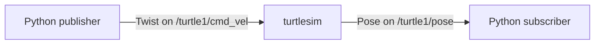
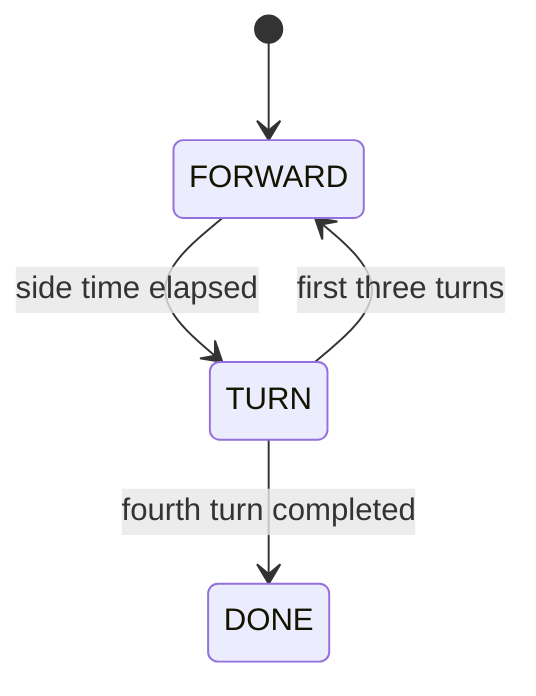
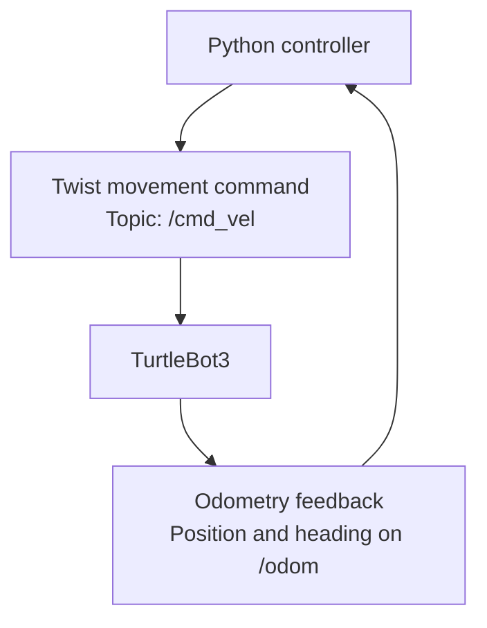

# Lab 4 — Writing ROS 2 Nodes and Controlling a Robot

In Lab 3, you drove the TurtleBot3 using existing ROS 2 tools. Now you'll write your own Python nodes. You'll send and receive messages in turtlesim, program a timed square, then use the robot's odometry to decide when movements should finish. The aim is to understand the difference between **sending a command** and **knowing what happened**.

Work through the exercises in order: read the explanation, open the linked Python file, complete its `TODO` tasks, save it, run the command and check what happened. The five files in [`exercises/`](exercises/) are intentionally unfinished. A node's startup message does not prove that its task worked.

---

## 1. Before you start

### 1.1 Set up Lab 4 in your team's workspace

You'll edit and run the five Python exercise files **on your team's miniPC**, from your team's own local workspace. Reading them on GitHub does not put them on the miniPC.

If the exercise files are not already in your team's workspace, get them from this repository: on GitHub, select **Code → Download ZIP**, extract it, and copy the `4/exercises/` folder into the Lab 4 folder of **your team's local repository**. A downloaded ZIP may contain an extra folder ending in `-main`; open that folder to find `4/exercises/`. Keep all five `.py` files together. If the link or exercise folder is missing, ask a demonstrator for the approved files before continuing.

From the **root of your team's local repository** (the top-level folder of your team's project), enter its Lab 4 folder. Choose **one** command that matches your team's layout:

If the folder is called `4/`:

```bash
cd 4
```

If it is under `labs/4/`:

```bash
cd labs/4
```

Check you're in the right place and the files have been copied:

```bash
pwd
ls exercises
```

`ls exercises` should show `minimal_publisher.py`, `minimal_subscriber.py`, `square_driver.py`, `odom_monitor.py` and `closed_loop_square.py`. If it says `No such file or directory`, check both your location and whether you've copied the folder. **All exercise commands below run from this Lab 4 folder**; don't use the shorter run examples inside some Python file headers.

In **every new terminal**, navigate to this same local Lab 4 folder and activate ROS 2 Humble, following [Lab 2, Section 1.1](../2/README.md#11-make-sure-your-environment-is-active). For a system-wide Ubuntu installation:

```bash
source /opt/ros/humble/setup.bash
```

Use the ROS 2 setup provided for your team miniPC; do not mix different ROS installations. For the physical-robot exercises, your miniPC and TurtleBot3 must have the same `ROS_DOMAIN_ID`. If `python` is unavailable, use `python3` (for example, `python3 exercises/minimal_subscriber.py`).

| Terminal | Purpose during the turtlesim exercises |
|---|---|
| **A** | Runs turtlesim. Leave it open. |
| **B** | Runs your publisher or square driver. |
| **C** | Runs your subscriber or a diagnostic command. |

Keep long-running nodes in separate terminals. Use **Ctrl+C** to stop them when instructed.

### 1.2 If something doesn't work

If a command fails, read the error before changing anything. First work out **where** the failure occurs: can Python find and start the file, are ROS messages reaching the correct topic, or is the program running but producing the wrong result? The checks alongside each exercise help you distinguish these cases. After changing a `.py` file, stop the running node with Ctrl+C and run it again; it does not automatically load your edits.

If you need a demonstrator, show the command, the error or unexpected result, and one check you've tried. **If a physical robot moves unexpectedly, use the demonstrator's stop procedure immediately; do not troubleshoot while it is moving.**

Sections 2 and 3.1–3.2 use **turtlesim only**. Wait until Section 3.3 to prepare the physical robot.

---

## 2. Sending commands and receiving data

A ROS 2 **node** is a program that communicates with other nodes. **Publishers** send messages to topics; **subscribers** receive them. Turtlesim accepts movement commands and reports its pose:



A `Twist` requests motion: `linear.x` is forward velocity and `angular.z` is turning velocity. On the robot these use m/s and rad/s; turtlesim uses simulated distance units. A turtlesim `Pose` reports position and heading.

In the Python files, `class ...(Node)` defines a node, `__init__()` sets it up, and `self` stores its state. `rclpy.init()` starts ROS communication; `rclpy.spin(node)` allows **callbacks** to run. Timers trigger callbacks at intervals; subscriptions trigger them when messages arrive. The queue depth of 10 stores up to ten recent messages. This basic structure is already supplied. Where you see `pass`, it is a Python placeholder that does nothing; your TODO code must provide the missing behaviour.

**Terminal A — start the simulator:**

```bash
ros2 run turtlesim turtlesim_node
```

A window opens with a turtle near the centre. Leave it running through Section 3.2.

### 2.1 Send a movement command

A publisher needs a topic and a message. Here, a timer calls your function every 0.5 seconds; creating a `Twist` alone does not send it.

Open [`exercises/minimal_publisher.py`](exercises/minimal_publisher.py). Read `__init__()` and `timer_callback()`, then complete TODOs 1–4: create the publisher and timer, set a small forward speed and publish each message. Save the file.

The code uses relative topic `cmd_vel`, whereas turtlesim listens on `/turtle1/cmd_vel`. ROS 2 can connect them through command-line topic remapping.

**Terminal B — run your completed program:**

```bash
python exercises/minimal_publisher.py --ros-args -r cmd_vel:=/turtle1/cmd_vel
```

`--ros-args -r` **remaps** `cmd_vel` to turtlesim's topic without changing the Python code. **Do not run this introductory publisher on the physical robot.**

**Expected:** The turtle moves forward. Run this briefly so it does not reach the window edge. If it stays still, check the TODOs and remapping. To see whether velocity messages are arriving, use **Terminal C**:

```bash
ros2 topic echo /turtle1/cmd_vel --once
```

Use the result to narrow down the problem. **No message?** Check that the timer calls your callback, that the callback publishes, and that the topic is remapped. **A message with `linear.x: 0.0`?** Check where you set the forward speed. **A non-zero speed but no movement?** Check whether turtlesim is running and whether the turtle has reached the window edge. Stop and restart your Python program after editing it.

Would a shorter timer interval increase the speed, or only how frequently you send the command?

**Stop the publisher in Terminal B after this test.** Leave turtlesim running while you complete the subscriber.

### 2.2 Read the turtle's position

The subscriber reads the turtle's `Pose`: `x`, `y` and `theta` (heading in radians). Its callback runs on incoming pose messages, not on a timer.

Open [`exercises/minimal_subscriber.py`](exercises/minimal_subscriber.py). Read `__init__()` and `pose_callback()`, complete TODOs 1–2 to subscribe and display those fields, then save and run it in **Terminal C:**

```bash
python exercises/minimal_subscriber.py
```

**Expected:** Pose readings appear, initially with little or no change. **Restart the publisher in Terminal B** using the command from Section 2.1. Its movement should change the subscriber readings. Stop the publisher before the turtle reaches the edge; if readings stay fixed, check whether the turtle is moving.

If no pose readings appear, stop the subscriber and check the source in Terminal C:

```bash
ros2 topic echo /turtle1/pose --once
```

If the command shows pose messages but your Python node prints nothing, the problem is probably in your subscription or callback, not in turtlesim. If the topic itself is silent, check that turtlesim is running. Stop the echo with Ctrl+C if it does not return. Who sets the callback rate? Real robot sensors use the same pattern.

**Before the square:** Stop the publisher in Terminal B and the subscriber in Terminal C with Ctrl+C. Keep turtlesim open. In a free ROS-sourced terminal, reset the turtle:

```bash
ros2 service call /reset std_srvs/srv/Empty "{}"
```

This uses the service from Lab 2. Check that the turtle returns to the centre. **Stop previous movement publishers before launching another.**

---

## 3. Driving a square without feedback

This controller moves forward and turns for **fixed durations**, without checking position. That's *open-loop control*: it cannot detect a mismatch between commanded and actual motion.

### 3.1 Understand the square-driver scaffold

A timed **state machine** switches between travelling forward and turning. After the fourth turn, it stops:



Now open [`exercises/square_driver.py`](exercises/square_driver.py). The publisher and timer are supplied. `self.phase` identifies the movement, `self.phase_elapsed` tracks its duration, and `self.legs_done` counts completed side-and-turn cycles. The `DONE` branch already sends zero velocity and cancels the timer.

Read the constants and trace `tick()` before editing. TODO 1 asks you to define `FORWARD_TIME` and `TURN_TIME` from the given distance, angle and speeds. The lines with `...` are **comments**, not working definitions. TODOs 2–5 implement movement and transitions.

Before running, check when `phase_elapsed` must reset and how the fourth turn leads to `DONE`, not another side. **Save the completed file** before moving to Section 3.2.

### 3.2 Test the square in turtlesim

Make sure your earlier publisher is stopped and turtlesim is still running. **Terminal B:**

```bash
python exercises/square_driver.py --ros-args -r cmd_vel:=/turtle1/cmd_vel
```

**Expected:** Four sides and four turns, ending near the start. If Python reports a `NameError` for `FORWARD_TIME` or `TURN_TIME`, check TODO 1: commented placeholders do not define variables. If the turtle never turns, inspect the state changes and timer resets; if the shape is wrong, check durations and units.

**Before moving to the robot:** the square must run successfully in turtlesim, and you should be able to explain when it changes from `FORWARD` to `TURN` and finally to `DONE`. If it does not work, use the checks above and ask a demonstrator before proceeding.

After the square, press **Ctrl+C in Terminal B**. `DONE` cancels the timer but not the Python process. Stop turtlesim before using the physical robot.

The controller knows how long it commanded movement. Does it know how far the turtle travelled?

### 3.3 Read odometry from the TurtleBot3

**The rest of the lab uses the physical TurtleBot3 under demonstrator supervision.** Follow [Lab 3, Section 1](../3/README.md#1-reconnect-your-robot-lab-1-recap): check your group's `ROS_DOMAIN_ID`, SSH into the robot and start bringup. Keep the SSH session running. Run the odometry monitor and movement scripts in separate **miniPC terminals**, not in the robot's SSH session.

From a ROS-sourced miniPC terminal on the same domain ID, check the topics:

```bash
ros2 topic list
```

You should see `/cmd_vel`, `/odom`, `/tf` and `/scan`. If `/odom` is missing, ask a demonstrator to check the connection **before driving**.

The TurtleBot3 reports estimated position, orientation and velocity on `/odom` (`nav_msgs/Odometry`). Unlike turtlesim's single `theta` angle, orientation is a **quaternion** (four values: `x, y, z, w`). You'll convert it to **yaw**, the robot's heading in the ground plane; revisit [Lab 3, Section 4.1](../3/README.md#41-record-a-stationary-baseline) if needed. Odometry can drift from the true position.

Open [`exercises/odom_monitor.py`](exercises/odom_monitor.py). Read `quaternion_to_yaw()`, `__init__()` and `odom_callback()`, then complete TODOs 1–3: calculate yaw, subscribe to `/odom`, and display pose and velocity. The `return 0.0` is a placeholder to replace. Convert the returned yaw (radians) to degrees for your output, and save the file.

In a new terminal on your team's miniPC, from the Lab 4 folder used in Section 1.1:

```bash
python exercises/odom_monitor.py
```

**Expected:** Position, heading and velocity readings from `/odom`. A stationary robot can have an unchanged heading; after a supervised turn, a heading stuck at zero may indicate that you left the yaw placeholder in place. Leave the monitor running for both trials. If nothing prints, check the source in another terminal:

```bash
ros2 topic echo /odom --once
```

If `/odom` is silent, **do not drive**; ask a demonstrator to check bringup. If it works, inspect your subscription and callback.

### 3.4 Run your square on the TurtleBot3

You've successfully driven a square in turtlesim. Now it's time to try the same program on the real TurtleBot3.

You already have the Python file you need: [`exercises/square_driver.py`](exercises/square_driver.py). In Section 3.1, you completed its five TODOs to make the robot move forward, turn and stop after four sides. In Section 3.2, you tested that code in turtlesim.

**You don't need to write another program.** Use the same saved file. If you haven't completed the TODOs or your square didn't work in turtlesim, return to Sections 3.1–3.2 before continuing.

The aim is to see how the real robot behaves when we control its movements using time alone.

#### Step 1 — Prepare the robot

With your demonstrator:

1. Place the TurtleBot3 in the approved testing area, with enough clear space around the planned 1 m square.
2. Make sure robot bringup is running, the miniPC and robot use the same `ROS_DOMAIN_ID`, and `/odom` is available.
3. Stop any previous driving programs or teleop. Only one program should control `/cmd_vel` at a time.
4. Check the movement speeds and agree on how to stop the robot before starting.

**Safety:** Keep the area clear and the robot supervised. For a normal stop, press Ctrl+C in the driving program's terminal and check that the robot has stopped. If movement becomes unsafe, stay clear and follow your demonstrator's emergency-stop procedure immediately. Stopping bringup or sending a single zero-velocity message is not a reliable emergency stop. Cutting power may be necessary in an emergency, but isn't a normal shutdown method; see [Lab 1, Section 5.6](../1/README.md#56-shut-the-robot-down). These safety instructions also apply to Section 4.2.

Keep the robot's SSH bringup terminal running. Your Python programs run **on the team miniPC**, not in the robot's SSH terminal.

#### Step 2 — Record your starting position

If `odom_monitor.py` is still running from Section 3.3, leave it running. Otherwise, open a ROS-sourced miniPC terminal, navigate to your Lab 4 folder and start it:

```bash
python exercises/odom_monitor.py
```

You should see the robot's position, heading and velocity updating.

Before moving the robot, write down its current `x` and `y` coordinates. These are your starting position.

Leave the monitor running while you test the square.

#### Step 3 — Run your square driver

Open another ROS-sourced terminal on the miniPC and navigate to the same Lab 4 folder.

Run the `square_driver.py` program you completed and tested earlier:

```bash
python exercises/square_driver.py
```

Notice that we haven't used the turtlesim remapping this time. The same `cmd_vel` publisher now sends commands to the real TurtleBot3 through `/cmd_vel`.

Watch the robot attempt to:

1. Move forward approximately 1 metre.
2. Turn approximately 90°.
3. Repeat until it has completed four sides and four turns.
4. Stop after the final turn.

The full movement should take roughly 33 seconds. Stay with your demonstrator throughout and use the agreed stop procedure if anything unexpected happens.

#### Step 4 — Record what happened

Once the robot has finished and is stationary, press Ctrl+C in the square-driver terminal.

Look at your odometry monitor and record the final `x` and `y` coordinates.

| Measurement | Your result |
|---|---|
| Starting position `(x, y)` | |
| Final position `(x, y)` | |
| Did the robot complete four sides and turns? | |
| Did it stop after the fourth turn? | |
| Did it finish close to where it started? | |

Keep the odometry monitor available for Section 4.

#### Step 5 — What did you notice?

Compare the real robot's movement with what you saw in turtlesim.

Did it follow a perfect square? Did it finish exactly where it started?

Your program told the robot how long to move forward and how long to turn. It never checked how far the robot actually travelled.

On a real robot, wheel slip, acceleration and floor conditions can all affect the result.

This is the main limitation of **open-loop control**: the robot follows instructions without using feedback to check its progress.

**In Section 4, you'll change that.** Instead of relying on a timer, your next controller will use odometry to decide when each movement is complete.

---

## 4. Closing the loop

Here, **odometry-estimated progress** ends each movement instead of a timer. The subscription callback updates pose; the timer callback decides whether to continue or change state. This is *closed-loop control*.



Feedback can help a mobile robot approach a target, but `/odom` is an estimate, not an exact position measurement.

### 4.1 Build the feedback-controlled square

In Section 3, `square_driver.py` moved for fixed amounts of time. Now you'll complete **a different scaffold**, [`exercises/closed_loop_square.py`](exercises/closed_loop_square.py), so the robot can use odometry to decide when each movement is finished.

Open the file and read `quaternion_to_yaw()`, `__init__()`, `odom_callback()` and `tick()` in that order. The publisher, timer, state variables and `DONE` stopping behaviour are already provided. Complete the seven TODOs:

1. **TODOs 1–3:** Convert the odometry quaternion to yaw, subscribe to `/odom` and store the latest `(x, y, yaw)` in `self.pose`.
2. **TODOs 4–5:** Measure how far the robot has travelled from the start of the current side and decide when to begin turning.
3. **TODOs 6–7:** Measure the turn from its starting heading, handle wraparound at ±π, and move to the next side or finish after the fourth turn.

`self.leg_start_pose` marks the start of each forward or turning phase. Reset it when changing phases; otherwise the next distance or angle will be measured from the wrong place. The supplied tolerances let a movement finish when it is close enough to its target.

Before testing, make sure you've replaced the placeholder `return 0.0` in `quaternion_to_yaw()`, completed all seven TODOs and **saved the file**. You do not need to change the topic names or copy code from the timed-square driver.

**This is a robot-only exercise.** Turtlesim publishes `/turtle1/pose`, not the `/odom` messages this controller needs. The scaffold waits for its first odometry reading, but it has **no timeout if odometry stops updating later**. Never run it unattended.

### 4.2 Test the feedback-controlled square

You'll now run the controller you completed in Section 4.1 on the TurtleBot3. Keep the same demonstrator supervision and stopping procedure used in Section 3.4.

#### Step 1 — Check the robot and record your starting position

Make sure robot bringup is still running, `/odom` messages are arriving and the timed square driver and teleop are stopped. Only the closed-loop driver should command `/cmd_vel` during this test.

Keep `odom_monitor.py` running from Section 3.4, or restart it using that section's command. With the robot stationary in the approved testing area, **record a new starting `(x, y)`**. Don't reuse the starting values from the timed-square test.

#### Step 2 — Run your completed controller

In another ROS-sourced terminal **on your team's miniPC**, from the same Lab 4 folder, run:

```bash
python exercises/closed_loop_square.py
```

Watch for four straight movements and four turns, followed by an automatic stop. This time the movement durations depend on odometry rather than a fixed timer.

If the robot moves unexpectedly, stops responding or odometry readings stop arriving, **follow the demonstrator's stop procedure before investigating the code**. Do not troubleshoot while the robot is moving.

#### Step 3 — Record and compare

Once the robot is stationary, press Ctrl+C in the controller terminal. Record the final `(x, y)` from your odometry monitor.

For each trial, calculate the distance between its own starting and finishing positions:

`return-to-start distance = sqrt((x_end - x_start)^2 + (y_end - y_start)^2)`

| From `odom_monitor.py` | Timed square | Feedback-controlled square |
|---|---|---|
| Start `(x, y)` in metres | | |
| Finish `(x, y)` in metres | | |
| Estimated return-to-start distance | | |

Which run appears closer to its starting point **according to odometry**? Does that match what you observed on the floor?

The feedback controller uses estimated distance and heading to finish each movement, but odometry can drift. **A better return-to-start result is not guaranteed.**

---

## 5. Extensions (optional)

Sections 3 and 4 compared where the robot finished. These extensions compare the full paths, test sensitivity to timed movement and apply feedback to a new target. All physical robot runs require the supervision, clearance and stop procedure from Section 3.4.

### 5.1 Log both paths and plot them

**Goal:** Compare the open-loop and closed-loop trajectories with an ideal 1 m square.

1. Extend a copy of `odom_monitor.py` (or write a logger) to save one row per `/odom` message in a CSV with columns `time_s,x_m,y_m,yaw_rad`.
2. Record the open-loop and closed-loop squares separately as `open_loop.csv` and `closed_loop.csv`. Start logging before each run and stop after the robot is stationary. If you did not record Sections 3.4 and 4.2, repeat them under supervision.
3. For each run, subtract its starting `(x, y)` and rotate by the negative starting yaw, so both paths begin at `(0, 0)` facing +x. Plot both against an ideal 1 m × 1 m square matching the driver's turning direction, using equal-scale axes labelled in metres.
4. Compare the sides, corners and return-to-start offsets. What improved, and what did not?

**Expected output:** Two CSV files, one labelled plot and a short explanation. These `/odom` trajectories are estimates, not ground-truth physical paths.

### 5.2 Tune the open-loop square

**Goal:** Investigate the limitations of fixed-duration movement.

1. Adapt a **copy** of `square_driver.py` to command one straight 5 s movement at `LINEAR_SPEED` under demonstrator supervision.
2. Compare its `/odom`-estimated displacement against `LINEAR_SPEED × 5 s`. Adjust the duration, rerun the square and compare return-to-start offsets before and after.
3. With demonstrator approval and enough clearance, test on another surface. Otherwise, predict how changing the surface would affect your calibration.

**Expected output:** Original and adjusted measurements with a short explanation.

### 5.3 Drive to an arbitrary point

**Goal:** Generalise closed-loop control beyond fixed 1 m legs and 90° turns.

1. Work from a **copy** of `closed_loop_square.py` and define a target `(x_goal, y_goal)` in the `/odom` frame.
2. From each updated pose, recompute the distance and heading error to the target and use them to update movement commands.
3. Stop within a chosen position tolerance. Test only a demonstrator-approved, reachable goal in a clear area.

**Expected output:** Target, final odometry estimate, position error and a short explanation. Final heading alignment is optional.

---

## 6. Before you leave

- [ ] Explain why a publisher and subscriber need matching topics and message types.
- [ ] Show the timed square in turtlesim and explain its state changes.
- [ ] Record starting and finishing odometry for both supervised robot trials.
- [ ] Compare the estimated return-to-start distances and explain possible differences.
- [ ] Explain one diagnostic check you used (or would use) when a node runs but behaves incorrectly.

Extensions are optional.

## 7. Troubleshooting reference

| Problem | First thing to check |
|---|---|
| Python cannot open an exercise file | Run `pwd` and `ls exercises`; return to the correct local Lab 4 folder. |
| `python: command not found` | Try `python3` with the same ROS environment active. |
| `ModuleNotFoundError: rclpy` | Check that the Python interpreter matches the ROS 2 environment you sourced. |
| Publisher starts but turtle stays still | Check `/turtle1/cmd_vel` using Section 2.1. No message, zero speed and blocked motion have different causes. |
| Subscriber prints nothing | Check `/turtle1/pose`, then the subscription and callback. |
| Square doesn't turn or looks wrong | Inspect state changes, timing resets and speed units. |
| `rcl_shutdown already called` after Ctrl+C | This can be a ROS 2 shutdown exception. Check that motion has stopped; it does not establish whether the movement task worked. Ask a demonstrator if unsure. |
| Robot topics or `/odom` are missing | **Do not drive.** Ask a demonstrator to check `ROS_DOMAIN_ID`, lab network settings and bringup. |
| Closed-loop controller behaves unexpectedly | **Stop the robot safely first.** Then inspect odometry and control logic with a demonstrator. |
| Robot continues moving or risks collision | **Stay clear. Follow the demonstrator's emergency-stop procedure immediately.** |
