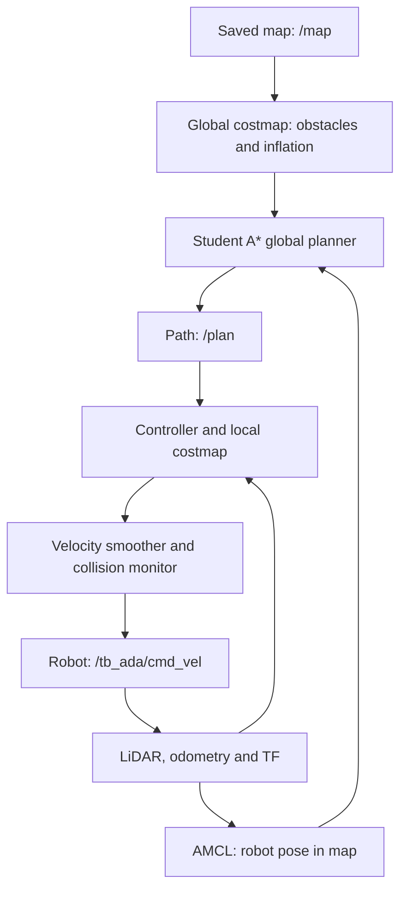
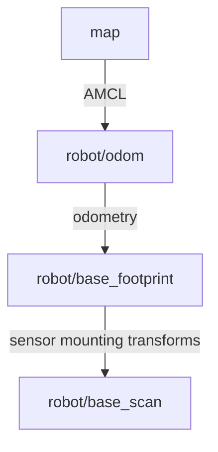
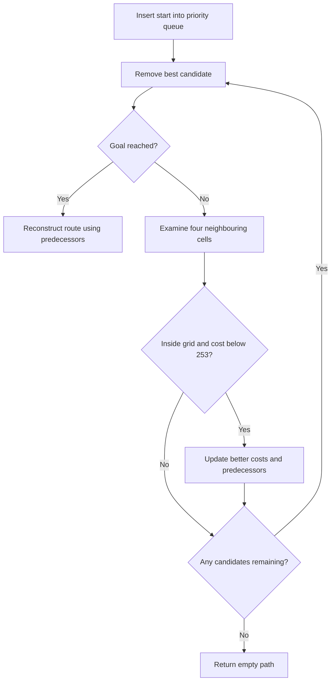

# Lab 6 — A* Path Planning and Nav2 Navigation: Simulation to Real Robot

**COMP0182 Real-World Multi-Agent Systems · ROS 2 Humble · TurtleBot3 Burger · 2-hour practical**

> **The challenge:** Can your robot plan a route, follow it and visit a sequence of inspection points?

Lab 5 introduced mapping and localisation. In this lab, we implement **A\*** for navigation and connect it to the supplied **Nav2** stack. Test it in Gazebo, then reuse it for **one physical Nav2 mission** in the block arena.

| Section | Activity | Suggested time |
|---|---|---:|
| 0 | Set up `.env`, build and check the infrastructure | 10 min |
| 1 | Understand Nav2, costmaps, planning and control | 10 min |
| 2 | Localise in the house simulation | 15 min |
| 3 | Implement and test A* | 30 min |
| 4 | Navigate in simulation and compare one tuning change | 20 min |
| 5 | Physical task: inspect two locations using Nav2 | 25 min |
| — | Transition, robot allocation and troubleshooting | 10 min |
| | **Total** | **120 min** |

Complete Sections 0–4 before the physical task. Staff prepare the robot and physical map. Let them know when you are ready to proceed in the real-world.

For file and command reference, see [CODE_README.md](CODE_README.md). Follow this worksheet for the task order.

---

## 0. Set up, build and check Lab 6

### 0.1 Find the files and configure `.env` once

Download the files from the [course repository](https://github.com/adelibasi/COMP0182-Labs-26-27), using **Code → Download ZIP**, or obtain the approved package from a demonstrator. Copy the **complete `6/` folder**, including `.env.example`, into your team's repository as **`labs/6`**. The distributed folder and your working directory have different locations:

```text
Course distribution:  6/
Your team's workspace: labs/6/
```

From your team's repository root:

```bash
cd labs/6 || exit 1
test -f .env || cp .env.example .env
```

**Configure the lab in `labs/6/.env`.** Replace both `REPLACE_WITH_...` placeholders, then use the short Make commands below. Keep the simulation settings in this file; update them for the physical robot in Section 5.

| Setting in `labs/6/.env` | Simulation value |
|---|---|
| `ROBOT_NAME` | Complete name, for example `tb_ada`; use your assigned name if different |
| `ROS_DOMAIN_ID` | Your assigned number from Labs 1/5, normally 30 + your group number; use the staff allocation |
| `ROS_LOCALHOST_ONLY` | `1` — simulation stays on this computer |
| `USE_SIM_TIME` | `true` |

Add these entries if they are not already present:

```text
export TURTLEBOT3_MODEL=burger
export GUI=true
export MAP=maps/house.yaml
export RMW_IMPLEMENTATION=rmw_fastrtps_cpp
```

**Naming matters:** Lab 5 added `tb_` to a short name such as `ada`. Lab 6 requires the complete `tb_<name>`, with a non-empty suffix containing only letters, digits or underscores. Use your allocated name exactly: `ada`, `tb_`, spaces, hyphens and leading `/` are rejected. For `tb_ada`, robot topics are `/tb_ada/scan`, `/tb_ada/odom` and `/tb_ada/cmd_vel`.

Use the assigned domain consistently. Do not copy another group's physical domain or use a simulation domain that is shared with an active physical robot.

### 0.2 Configure the ROS environment

ROS 2 relies on environment variables for package discovery, communication and simulation settings.

**In each new terminal**, load ROS 2 Humble and your TurtleBot3 workspace (if installed):

```bash
source /opt/ros/humble/setup.bash
source ~/turtlebot3_ws/install/local_setup.bash
```

Your team has been provided with a `.env` file in `labs/6` containing its assigned robot name, ROS domain and other configuration.

**The Makefile reads `.env` automatically.** You do not need to source it or manually export variables when using the provided Make commands.

For direct `ros2` commands, load the exported settings from `labs/6`:

```bash
source .env
```

From `labs/6`, run `make help` to see the available commands and inspect your active configuration:

```text
ROS variables:
  ROBOT_NAME: tb_ada (source: .env)
  ROS_DOMAIN_ID: 36 (source: .env)
  ROS_LOCALHOST_ONLY: 1 (source: .env)
  USE_SIM_TIME: true (source: .env)
  GUI: true (source: .env)
  MAP: maps/house.yaml (source: .env)
  TURTLEBOT3_MODEL: burger (source: .env)
```

Check that your robot name and domain match your assignment. For simulation, ensure `ROS_LOCALHOST_ONLY=1` and `USE_SIM_TIME=true`. The displayed source indicates where each value was obtained.

Changes to `.env` are picked up by subsequent Make commands. Already-running ROS nodes must be restarted to use the new configuration.

### 0.3 Build and check the supplied infrastructure

With other Lab 6 launches stopped, run once:

```bash
make build
make check
```

`make build` compiles `lab6_planner_interfaces` and `lab6_planner`. `make check` starts its **own headless simulation**, saved-map localisation and Nav2 stack, then tests a goal and two waypoints using a **supplied route fixture**. Let it finish and clean up before opening the interactive simulation.

Expected milestones:

```text
PASS: simulated scan and odometry
PASS: saved map, AMCL and map-to-robot transform
PASS: Nav2 active with only the Student planner
PASS: navigation goal and two waypoints; waypoint travel ... m
The A* algorithm was not tested; run make test-a-star.
```

The check prints a temporary localhost-only domain in **50–99**, excluding your assigned domain. Do not put this temporary number into `.env`. Logs are under `/tmp/pgta_mas/lab6-*.log`; show a demonstrator the first failure rather than repeatedly restarting components.

**`make check` does not test or complete your A* implementation.** You will test your own function in Section 3. Do not repeat the build and infrastructure check in every terminal.

### Simulation terminal layout

Prepare each terminal using Section 0.2. Keep long-running commands open.

| Terminal | Command | Purpose |
|---|---|---|
| A | `make sim` | Gazebo house and TurtleBot |
| B | `make localise` | Supplied house map and AMCL |
| C | `make rviz` | Map, robot, scans and paths |
| D | Checks below; `make teleop` only when needed | Diagnostics or manual control |
| E | `make nav` **in Section 4** | Navigation using your completed A* |

Start **A, then B, then C**. Set the initial pose in Section 2. Start E only after your A* tests pass. **Stop teleop before Nav2; stop Nav2 before using teleop.** These are alternative command sources, not commands to leave running together.

---

## 1. Understand the Nav2 navigation stack (10 min)

In Lab 5 you commanded velocity and observed motion. Nav2 adds a destination, a planned route and feedback control.



| Component | Responsibility | Not its responsibility |
|---|---|---|
| Map Server | Load `maps/house.yaml` and its PGM occupancy grid | Build a new map or find a route |
| AMCL | Estimate pose using the map, LiDAR and odometry | Drive the robot or choose destinations |
| Global costmap | Combine map obstacles, live observations and inflation costs | Command the wheels |
| Student global planner | Find a route through the current global costmap | Execute the route |
| Controller and local costmap | Follow the route using local observations and feedback | Replace the global search algorithm |

The **global costmap** is the grid A* searches. Inflation assigns higher costs near obstacles; not every coloured cell is blocked. The **local costmap** is a rolling view around the robot used by the controller. A globally valid route may become unsafe locally when an obstacle moves.

The supplied Nav2 plugin, named `Student`, passes the current global costmap to `/student_plan`. That Python service calls your `a_star_impl()` and returns the path. Only the Student global planner is configured; this is not a demonstration using a separate built-in planner.

**Discuss:** Which component estimates position? Which finds a route? Why can a planning action succeed without any movement?

---

## 2. Localise in the house simulation (15 min)

### 2.1 Check the map and sensors

Keep `make sim`, `make localise` and `make rviz` running. The supplied house map is already available; you do not map the simulation again.



In prepared Terminal D:

```bash
ros2 lifecycle get /map_server
ros2 lifecycle get "/${ROBOT_NAME}/amcl"
ros2 topic info /map
ros2 topic info "/${ROBOT_NAME}/scan"
ros2 topic info "/${ROBOT_NAME}/odom"
```

Require the lifecycle nodes to report `active [3]`, a map publisher and the robot's sensor publishers. A map **topic** and a map **TF frame** are different: AMCL needs an initial pose before it can provide a useful `map → robot/odom` transform.

### 2.2 Set the initial pose in RViz

Set **Fixed Frame** to `map`. Enable **Map** on `/map`, **Robot**, and **Scan** on your robot's scan topic, using **Best Effort** reliability. For example, `ROBOT_NAME=tb_ada` gives `/tb_ada/scan`; RViz text fields do not expand shell variables.

Use **2D Pose Estimate**, not Nav2 Goal. Click the robot's approximate location in the corresponding room on the saved map and drag to indicate its heading. Use Gazebo's layout to orient yourself and compare the laser returns with the mapped walls. Gazebo world coordinates should not be assumed to be calibrated map coordinates.

AMCL Pose and Particles can help show the estimate and its uncertainty. In Terminal D:

```bash
ros2 topic echo "/${ROBOT_NAME}/amcl_pose" --once \
  --qos-reliability reliable --qos-durability transient_local --qos-depth 1
ros2 run tf2_ros tf2_echo map "${ROBOT_NAME}/base_footprint"
```

Stop `tf2_echo` with Ctrl+C after numerical transforms appear. A short discovery warning followed by valid transforms is different from a persistent missing-frame error. If the scan does not align with the walls, correct the initial pose rather than restarting Gazebo.

For a short manual check **before Nav2 starts**, run `make teleop` in D, follow its keys, turn slowly and stop. Exit teleop before reusing D or starting E.

**Checkpoint:** the robot is at a plausible map position, laser returns align with surrounding walls and the map-to-robot transform resolves. Explain why AMCL needs an initial pose even though the map is supplied.

---

## 3. Implement your A* global planner (30 min)

Edit only [`exercises/planner.py`](exercises/planner.py). The supplied C++ plugin and Python adapter handle ROS integration, coordinate conversion and path validation. The student function remains unfinished:

```python
def a_star_impl(*, nav2_cost_map, start_point, goal_point):
    # Return consecutive (column, row) cells, including both endpoints.
    raise NotImplementedError("Implement A* in exercises/planner.py")
```

### 3.1 Understand the input

`nav2_cost_map` is a live `nav2_msgs/msg/Costmap`, not the saved PGM image. The adapter supplies valid, traversable start and goal cells.

| Input | Meaning |
|---|---|
| `metadata.size_x`, `metadata.size_y` | Width and height in cells |
| `metadata.resolution` | Metres per cell |
| `start_point`, `goal_point` | `(column, row)`, not `(row, column)` |
| `data[row * width + column]` | The cell's raw Nav2 cost |

| Cost | Meaning | May A* enter it? |
|---|---|---|
| `0` | Free | Yes |
| `1–252` | Traversable graded cost, increasing near obstacles | Yes |
| `253` | Inscribed/inflated obstacle boundary | No |
| `254` | Lethal obstacle | No |
| `255` | Unknown | No |

Still bounds-check every neighbour and reject costs 253–255. The adapter's endpoint validation does not perform the search for you.

### 3.2 Search, costs and reconstruction

Use **four-connected movement**: left, right, up and down. Diagonal movement is outside this assessment. With `g` equal to steps taken, use Manhattan distance for `h`:

$$
f(n)=g(n)+h(n), \qquad h(n)=|c_n-c_g|+|r_n-r_g|
$$

**Minimise steps first; among equally short routes, minimise accumulated entered-cell costs, excluding the start.** Do not combine these into an unrestricted weighted penalty that makes a longer route preferable.

Use a priority queue (`heapq`) and best-cost/predecessor records. Keep the best `(steps, accumulated_cost)` for each cell and order candidates by `(steps + Manhattan_distance, accumulated_cost)`. Update a record for fewer steps **or equal steps with lower accumulated cost**.



Return consecutive cells **including start and goal**, `[]` if disconnected, or `[start_point]` if start equals goal. Do not fabricate a path when search fails.

**Worked grid:** both routes around the wall take six steps. The lower corridor has smaller accumulated costs, so it wins the tie. `~` denotes a traversable but costly cell.

```text
.  ~  ~  ~  .
S  #  #  #  G
.  .  .  .  .
```

### 3.3 Test before moving

```bash
make test-a-star
```

Before implementation, `NotImplementedError` is expected; it is not an installation failure. The **19 student tests** include 15 map examples and four contract tests. They cover open corridors, detours, blocked/unknown cells, map edges, disconnected endpoints, four-direction movement and the two-part cost objective.

**Halfway checkpoint:** test the open corridor and start-equals-goal cases first. Ask a demonstrator for help with your queue and predecessor records before tackling more complex detours.

`make test-package` checks the supplied adapter/support code. Use `make test-a-star` to check your A* implementation.

**Checkpoint:** All student A* tests pass, and you can explain how the queue, best costs and predecessors change during search.

---

## 4. Navigate and inspect behaviour in simulation (20 min)

### 4.1 Start your Nav2 stack

Keep A–C running, stop teleop, and start **Terminal E**:

```bash
make nav
```

This starts the Student planning service and plugin, controller, costmaps, velocity smoother, collision monitor, navigator and waypoint follower. It does not start another Map Server or AMCL.

In D:

```bash
for node in planner_server controller_server bt_navigator collision_monitor; do
    ros2 lifecycle get "/$node"
done
ros2 param get /planner_server planner_plugins
ros2 action list -t
```

Require `active [3]`, planner `Student`, and the navigation actions. Names such as `/plan`, `/planner_server` and `/navigate_to_pose` are **root-level**; sensor and motor topics use the robot namespace.

### 4.2 Show the information you need in RViz

| Display | Topic or setting |
|---|---|
| Global Options | Fixed Frame `map` |
| Map | `/map` |
| Robot and Scan | Your robot; scan Best Effort |
| A* Plan (Path) | `/plan` |
| Global Costmap (Map display) | `/global_costmap/costmap`; alpha about `0.5`; costmap colour scheme |
| Local Costmap (optional Map display) | `/local_costmap/costmap` |

The supplied RViz view already includes **Global Costmap**. Enable the existing display, keep the live scan visible and use the mouse wheel to adjust the view.

A point can appear free on `/map` but be blocked on the live costmap. Colours are visual aids: raw costs 253–255 are blocked; graded costs below 253 are not automatically walls. Leave room for the robot's footprint and any final turn.

### 4.3 Plan without driving

In D, run this **before** clicking **Publish Point** in RViz:

```bash
ros2 topic echo /clicked_point --once
```

Choose a nearby known-free destination. Check `frame_id: map`, then enter its coordinates **one value per prompt**:

```bash
read -r -p "Goal x (metres): " GX
read -r -p "Goal y (metres): " GY
ros2 action send_goal /compute_path_to_pose \
  nav2_msgs/action/ComputePathToPose \
  "{goal: {header: {frame_id: map}, pose: {position: {x: $GX, y: $GY, z: 0.0}, orientation: {w: 1.0}}}, planner_id: Student, use_start: false}"
```

Require `SUCCEEDED`, a non-empty path in `map` and no movement. This requests planning from the current robot pose; it does not command the controller. An aborted request is not a usable path.

### 4.4 Follow a goal and practise cancellation

Use **Nav2 Goal** in RViz. Click a nearby clear destination and drag to specify its final heading. **Publish Point** selects coordinates; **2D Pose Estimate** initialises AMCL; **Nav2 Goal** requests movement.

Watch the path, the robot in Gazebo and the navigation result. The goal includes orientation: reaching its X/Y position alone may not satisfy the goal checker.

During an active simulated goal, use **Cancel** in the **Navigation 2** panel and confirm the robot stops. Then send a short goal and let it finish. Require a successful navigation result and visible arrival; an accepted goal or a displayed route is not completion. The last path may remain visible after an abort or completion, so use the result for the current goal, not the line alone.

If you edit your A* after starting E, stop Nav2 and rerun `make nav` to load the changed function. Do not restart the whole simulation.

### 4.5 Compare one tuning change

Open [`config/nav_tuning.yaml`](config/nav_tuning.yaml). Stop the robot and E, change **one** value, restart `make nav`, and repeat a comparable goal.

| Parameter | Supplied value | Simulation experiment | Observe |
|---|---:|---:|---|
| `max_speed_mps` | `0.18` | Reduce to `0.12` | Travel speed/time |
| `obstacle_cost_radius_m` | `0.55` | Increase to `0.65` | Wider graded cost bands; possible route change |
| `obstacle_cost_decay_factor` | `3.0` | Reduce to `2.0` | Slower decay of costs away from obstacles |
| `path_lookahead_m` | `0.30` | Inspect only | How far ahead the controller aims |

The planner orders paths by steps, then cost. Inflation changes its input; speed/lookahead affect execution. These are different controls. Keep footprint, collision-monitor settings and goal tolerances unchanged. Restore the supplied tuning before physical work.

| Trial | Prediction | Route and movement observed | Action result |
|---|---|---|---|
| Default | | | |
| One change | | | |

**Checkpoint:** your A* passes its tests, a simulated goal completes, cancellation stops the robot, and you can explain one tuning observation. Why might a valid path still fail during execution?

---

## 5. Physical task — explore the block arena with Nav2 (25 min)

**One supervised mission:** use your tested A* to visit two approved inspection points in the existing block layout. Begin with a short single-goal check, then submit the two points as one ordered mission. This is goal-directed Nav2 navigation, not automatic discovery of destinations.

### 5.1 Staff preparation and the physical `.env`

Staff provide the allocated TurtleBot, Humble drivers and command guard, an approved operating area and a physical stopping procedure. The Raspberry Pi runs the drivers; RTAB-Map, RViz and Nav2 run on the controlling laptop/miniPC. Students do not SSH into, provision or reconfigure the robot.

**Staff bringup — Terminal A on the Pi:** if the drivers are not already running, staff connect by SSH to the assigned robot and start the Humble drivers from the deployed TurtleBot package:

```bash
cd ~/turtlebot3 || exit 1
make tb-humble
```

Leave this terminal running during the physical task. The robot uses its staff-managed `~/turtlebot3/.env`; the laptop's Lab 6 `.env` must match its robot name and domain. Staff confirm the command guard is enabled before handing over.

Use one Nav2 stack per assigned physical domain. A unique robot name alone cannot isolate the root-level map, planner service and navigation actions.

Stop simulation Nav2, teleop, AMCL, RViz and Gazebo. Keep your completed A* and restore the supplied tuning. Edit the **same lab-local `.env`**:

| Setting | Physical value |
|---|---|
| `ROBOT_NAME` | Full namespace allocated by staff, including `tb_` |
| `ROS_DOMAIN_ID` | Staff-assigned physical domain, matching the robot |
| `ROS_LOCALHOST_ONLY` | `0` |
| `USE_SIM_TIME` | `false` |

**Repeat Section 0.2 in each physical terminal** and check the printed robot, domain and time settings. The physical task uses RTAB-Map; it does not use `maps/house.yaml` or `make localise`.

| Terminal | Physical use |
|---|---|
| A — staff | `make tb-humble` from `~/turtlebot3` on the Pi; start only if needed and keep running |
| B — staff/supervised | `make mapping` on the controlling computer; only if RTAB-Map is not already running |
| C | `make rviz` |
| D | Readiness checks, planning and goal commands |
| E | `make nav`, after readiness checks |
| Separate prepared terminal | Cancellation while D is waiting for an action result |

**Mapping prerequisite:** `make mapping` uses the existing hardware check and starts live RTAB-Map. Staff establish coverage of the intended route before navigation, using `make teleop` only with Nav2 stopped if manual mapping is needed. Leave the mapper running; do not start a second mapper or AMCL. The entire room need not be mapped, but the required route must connect through known traversable space. Keep the blocks in their mapped positions.

If RTAB-Map restarts, recheck the map and TF, then capture fresh goal and waypoint coordinates before moving.

### 5.2 Check the robot, map and navigation stack

In D:

```bash
make check-hardware
ros2 node list
ros2 topic list -t
ros2 topic info /map -v
ros2 run tf2_ros tf2_echo map "${ROBOT_NAME}/base_footprint"
```

Require the hardware `Ready` message, the single RTAB-Map source and numerical map-to-robot TF. Stop only `tf2_echo` with Ctrl+C. Staff must also confirm fresh scans/odometry and map coverage; a listed topic is not proof of current data. If a check fails, stop and ask staff—do not bypass it.

Start C with `make rviz`. Check the physical blocks against the live scan and robot pose. Do not use AMCL's 2D Pose Estimate in this RTAB-Map workflow. Stop teleop before starting E with `make nav`.

In D:

```bash
for node in planner_server controller_server bt_navigator collision_monitor waypoint_follower; do
    ros2 lifecycle get "/$node"
done
ros2 param get /planner_server planner_plugins
ros2 service type /student_plan
ros2 param get /waypoint_follower stop_on_failure
```

Require `active [3]`, `['Student']`, `lab6_planner_interfaces/srv/PlanPath`, and `stop_on_failure=true`. Use the map, scan, Global Costmap and A* Plan displays from Section 4.2 with the physical robot name. Do not infer readiness from the RViz navigation panel alone.

### 5.3 Prove one short goal

Read Section 5.5's stopping commands first. Staff approve a nearby goal, route clearance and final heading. Capture coordinates with `ros2 topic echo /clicked_point --once` followed by **Publish Point**, as in Section 4.3.

A heading is part of the goal. Use the table below with staff; `{w: 1.0}` means 0°, not “any orientation”. The axes are those of `map`, not the screen.

| Final heading | `qz` | `qw` |
|---|---:|---:|
| 0° / +X | 0 | 1 |
| +90° / +Y | 0.70710678 | 0.70710678 |
| 180° / −X | 1 | 0 |
| −90° / −Y | -0.70710678 | 0.70710678 |

In D, enter **one number per prompt**; staff may supply another suitable planar heading:

```bash
read -r -p "Goal x: " GX
read -r -p "Goal y: " GY
read -r -p "Final heading qz: " GZ
read -r -p "Final heading qw: " GW
GOAL="{header: {frame_id: map}, pose: {position: {x: $GX, y: $GY, z: 0.0}, orientation: {x: 0.0, y: 0.0, z: $GZ, w: $GW}}}"
ros2 action send_goal /compute_path_to_pose \
  nav2_msgs/action/ComputePathToPose \
  "{goal: $GOAL, planner_id: Student, use_start: false}"
```

Require `SUCCEEDED` and a non-empty plausible route. With staff approval, fresh sensor/TF data, a clear physical route and the physical stop available, send the **same pose in the same Terminal D**:

```bash
# MOVES THE REAL ROBOT — staff approval required.
ros2 action send_goal /navigate_to_pose \
  nav2_msgs/action/NavigateToPose "{pose: $GOAL}" --feedback
```

Require terminal `SUCCEEDED`, observed arrival and stopping. If it aborts after moving, retain the result and the first relevant Nav2 error. Do not loosen tolerances or repeatedly resend the goal. Resolve the failure with staff before attempting the waypoint mission.

### 5.4 Visit two inspection points in order

Choose two distinct staff-approved points, A and B, within the mapped layout, with room to turn. Neither leg should be a trivial already-at-goal request. These are inspection locations where the later coursework system could observe markers.

Use **Publish Point** for each location, starting the echo command before each click. In D, enter each coordinate and heading component separately:

```bash
read -r -p "Waypoint A x: " AX
read -r -p "Waypoint A y: " AY
read -r -p "Waypoint A qz: " AZ
read -r -p "Waypoint A qw: " AW
read -r -p "Waypoint B x: " BX
read -r -p "Waypoint B y: " BY
read -r -p "Waypoint B qz: " BZ
read -r -p "Waypoint B qw: " BW
WAYPOINT_A="{header: {frame_id: map}, pose: {position: {x: $AX, y: $AY, z: 0.0}, orientation: {x: 0.0, y: 0.0, z: $AZ, w: $AW}}}"
WAYPOINT_B="{header: {frame_id: map}, pose: {position: {x: $BX, y: $BY, z: 0.0}, orientation: {x: 0.0, y: 0.0, z: $BZ, w: $BW}}}"
```

Plan **current pose → A** without movement:

```bash
ros2 action send_goal /compute_path_to_pose \
  nav2_msgs/action/ComputePathToPose \
  "{goal: $WAYPOINT_A, planner_id: Student, use_start: false}"
```

After success, plan **A → B**, using A as a hypothetical start:

```bash
ros2 action send_goal /compute_path_to_pose \
  nav2_msgs/action/ComputePathToPose \
  "{start: $WAYPOINT_A, goal: $WAYPOINT_B, planner_id: Student, use_start: true}"
```

Require both plans to succeed and staff to approve their clearance. These are checks against the current costmap, not a guarantee that the environment will remain unchanged. Now submit **one ordered mission**:

```bash
# MOVES THE REAL ROBOT — staff approval required.
ros2 action send_goal /follow_waypoints \
  nav2_msgs/action/FollowWaypoints \
  "{poses: [$WAYPOINT_A, $WAYPOINT_B]}" --feedback
```

**Mission success:** feedback progresses through `current_waypoint: 0` then `1`, the robot visits A then B, the final result is `SUCCEEDED`, and `missed_waypoints: []`. An index identifies the target being pursued, not proof of arrival. The supplied configuration stops on a failed waypoint; do not change that to hide a failed leg.

### 5.5 Cancel, stop and explain the result

Use a separate prepared terminal. Cancel a single navigation goal with:

```bash
ros2 service call /navigate_to_pose/_action/cancel_goal \
  action_msgs/srv/CancelGoal "{}"
```

Cancel the **whole waypoint mission**, not merely its current child goal, with:

```bash
ros2 service call /follow_waypoints/_action/cancel_goal \
  action_msgs/srv/CancelGoal "{}"
```

These requests cancel all goals on the named action server in your assigned domain. Do not rely on Ctrl+C in the goal-sending terminal as a physical stop.

After the waypoint mission succeeds, choose and plan another short staff-approved goal using Section 5.3. Start navigation, then cancel it from the separate terminal while the robot is moving. Confirm `CANCELED` and that the **real robot stops and remains stationary**. Request acceptance alone is insufficient. If software stopping fails, use the staff-approved physical stop immediately; do not wait for diagnostics.

| Evidence | Record |
|---|---|
| Single goal | Requested pose, planning result and navigation result |
| Two-waypoint mission | A/B poses, final status and missed-waypoint list |
| Cancellation | Action result and observed physical stop |
| Explanation | One difference from simulation, and why a valid path may still abort during control |

**Physical checkpoint:** a completed single goal, ordered two-waypoint mission and observed cancellation, using your A* through the existing Nav2 stack. Record incomplete or failed trials honestly. This mission is the physical task; there is no additional extension to complete.

---

## Troubleshooting — use the failing checkpoint

| Observation | Check or action |
|---|---|
| Wrong robot, domain or simulation mode | Check the ROS Variables printed by `make help`. Correct `.env`, reload it in each terminal and restart only affected launches with staff guidance. |
| `Set ROBOT_NAME to tb_<NAME>` or a robot-name validation error | Set the full allocated name in `.env`. The suffix must contain letters, digits or underscores; leave no placeholder, blank value or `/`. |
| Map-file error | In simulation, check `MAP=maps/house.yaml` and that both YAML/PGM files exist in `labs/6/maps`. The Makefile variable is `MAP`. |
| `No rule to make target` | Work from the `labs/6` directory containing this Makefile. |
| `NotImplementedError` | Implement your A*; do not copy a completed staff reference. |
| Simulation map visible but no map-to-robot TF | Check AMCL is active and set its initial pose. Persistent TF failure is not normal startup. |
| Physical map/TF missing | Check the existing RTAB-Map session and live robot sensors with staff; do not start AMCL. |
| Lifecycle query waits, or CLI discovery seems inconsistent | Recheck `.env` in that terminal; with autonomous movement stopped, use the daemon check below. |
| Start/goal blocked or unknown | Inspect the **live global costmap**, not just `/map`; choose a staff-approved connected known-free route. Do not lower obstacle thresholds. |
| Robot is close but navigation aborts | Check the terminal action result, final heading and first Nav2 error. Proximity is not completion; do not relax tolerances to manufacture a pass. |
| An old green path remains | A displayed path is not current action status. Confirm a new planning result before using it as evidence. |
| Hardware check fails or sensors/TF become stale | Stop physical navigation and ask staff. Do not bypass the prerequisite. |

**Restart the daemon only if CLI discovery is inconsistent**—for example, node/topic lists appear stale or a query hangs after you have checked `.env`. Cancel active navigation and confirm the robot is stationary. From `labs/6` in a prepared diagnostics terminal:

```bash
source .env || exit 1
ros2 daemon stop
ros2 daemon start
ros2 node list
ros2 topic list -t
```

ROS 2 normally starts its daemon automatically. The block above refreshes CLI discovery for the domain loaded from `.env`; it does **not** restart the robot, fix missing live sensors, repair TF or cancel a goal. If the problem persists, show staff the exact error rather than restarting every component.

## Wrap-up and shutdown

Cancel active goals and confirm the robot is stationary. In simulation, stop Nav2, then AMCL, RViz and Gazebo. For physical hardware, follow the demonstrator's shutdown procedure and leave the Pi configuration unchanged.

Save your A* and observations. You should be able to explain the difference between a map and costmap, localisation and planning, a valid route and a completed navigation action, and a single goal and an ordered waypoint mission.

- [ ] My `.env` values match the robot and mode in each terminal.
- [ ] My A* passes all student tests.
- [ ] I observed successful simulated navigation and cancellation.
- [ ] I recorded the physical mission's actual outcome, including any failure.
- [ ] I can explain how waypoint navigation will support the coursework inspection task.

**The central lesson:** successful navigation needs the algorithm, sensors, localisation, costmaps and controller to work together.
