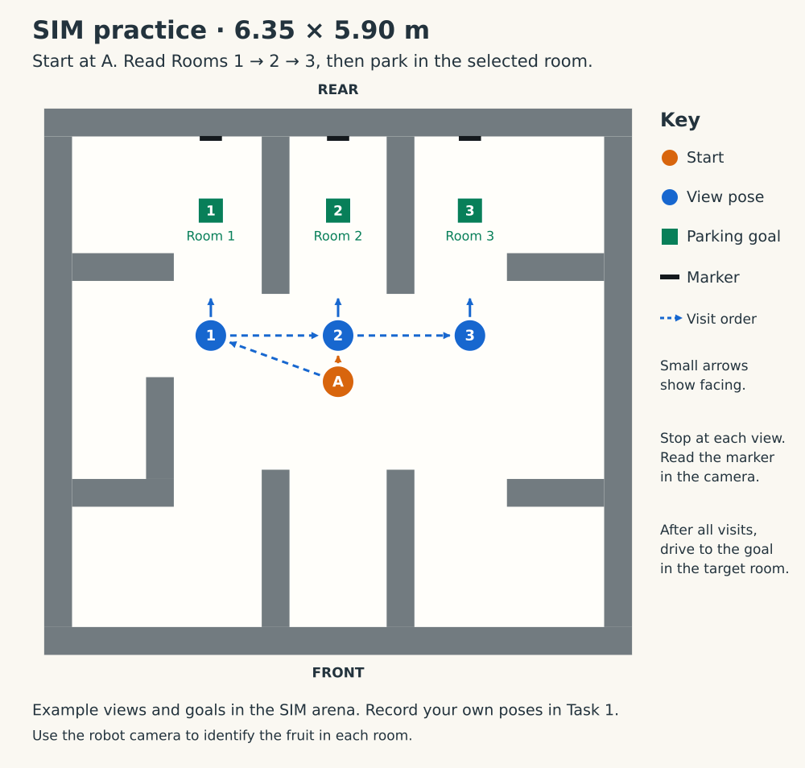

# Lab 7 — ArUco Marker Detection and Navigation

**COMP0182 · Real-World Multi-Agent Systems · ROS 2 Humble · TurtleBot3 Burger**

In Coursework Challenge 1, the robot starts at **A** and reads the signs for **Room 1 → Room 2 → Room 3**. After checking all three signs, it parks inside the room containing its assigned target.

First you'll drive and read the signs yourself. Then you'll make the robot do it automatically. Blind search is optional. Work at your own pace.

## The practice arena



The **view pose** is where the robot stops to read a room's sign. The **goal pose** is where it parks inside that room.

The practice marker key is **7 = banana, 23 = apple, 42 = strawberry**. Use the camera to find out which fruit is in each room. For REAL, use the key in `config/real_mission.yaml`.

## Before you start

Use your team's Lab 7 folder and your work from Labs 5 and 6. The arena and ROS setup are supplied. Set your allocated `ROBOT_NAME` and `ROS_DOMAIN_ID` in `.env`. For SIM, use `USE_SIM_TIME=true` and `ROS_LOCALHOST_ONLY=1`.

```bash
cd labs/7
test -f .env || cp .env.example .env
nano .env
make help
```

## SIM Task 1 — Read the signs by hand

**Goal:** Read the signs and record the stops your robot will use in Task 2. Check your assigned `target_fruit` in `config/sim_mission.yaml` before driving.

### A. Check the camera

Start Gazebo in Terminal A and the camera in Terminal B. Run the check in Terminal C. **Expected:** three usable images with advancing timestamps. Leave Gazebo and the camera running.

**Terminal A — start Gazebo**

```bash
make sim
```

**Terminal B — start the camera**

```bash
make decode
```

**Terminal C — check the camera**

```bash
make check
```

### B. Complete the detector and view the signs

Complete `detect_markers()` in `exercises/aruco_reader.py`. Given a camera image and a marker dictionary, return **IDs in ascending order** and their **matching corners**. If none are visible, return two empty lists. Detect what's in the image; don't hard-code a room.

**Check your detector**

```bash
bash scripts/python.sh tests/check_aruco.py
```

Once the detector check passes, restart `make decode` to load your changes, then open RViz. Look for an **outline, marker ID and fruit label**; do not count old or unreadable images.

**Terminal D — RViz**

```bash
make rviz
```

If **ArUco Camera** is blank, check that `make decode` is running. In another terminal:

```bash
source /opt/ros/humble/setup.bash
source .env
ros2 topic echo "/${ROBOT_NAME}/vision/observations" --field data
```

**Expected:** live readings with advancing timestamps when a marker is visible.

Once the camera check in Terminal C finishes, start localisation there and leave it running.

```bash
make localise
```

### C. Drive, stop and read

In a spare terminal, run `make pose` to see the robot's current pose in the map. Use the first two **Translation** values for x and y, and the last **Rotation in RPY (radian)** value for yaw. Copy them into the YAML as `[x, y, yaw]` while the robot is stopped.

Record `start_pose` at **A**. Use Terminal E to drive to Room 1, Room 2 and Room 3 in order. The YAML calls these `room_1`, `room_2` and `room_3` under `rooms`.

**Terminal E — manual driving**

```bash
make teleop
```

Stop where the camera can clearly read the sign and record `view_pose`. Then choose a sensible place for your robot to park inside the room and record `goal_pose`.

Keep each `goal_pose` at least 0.3 m from its `view_pose`, in a safe, reachable position inside the room.

Write each sign's ID and fruit in the table. If a sign is unreadable, adjust your view and try again. Choose the target room once all three readings are valid.

| Room | Marker ID | Fruit label | Anything you noticed |
|---|---|---|---|
| Room 1 |  |  |  |
| Room 2 |  |  |  |
| Room 3 |  |  |  |

**Assigned fruit:** ____________   **Chosen room:** ____________

## SIM Task 2 — Navigate to the target room

**Goal:** Make the robot read all three signs automatically and park in the room with the target fruit.

Use the same map and your completed `config/sim_mission.yaml` from Task 1. Reuse your Lab 6 navigation work.

### A. Complete and check the Task 2 exercise

Stop teleop and old SIM processes. Copy your completed Lab 6 `exercises/planner.py` into Lab 7's `exercises/planner.py`, then build the planner and mission packages.

**Build once (before opening the live terminals)**

```bash
make build
```

In `exercises/autonomous_search.py`, complete `navigate_to()` and `run_mission()` using the supplied Nav2, TF and marker reader:

1. In `navigate_to()`, send the supplied map pose and heading to Nav2. Check the action result and the robot's measured **map position and heading** before returning.
2. In `run_mission()`, call `self.marker_reader.read_marker()` **after** a verified arrival. The supplied reader checks for **three fresh, consistent images**; stop if it returns no reading.
3. Visit the `self.view_poses` for **Room 1**, **Room 2** and **Room 3** in `self.visit_order`, recording each reading.
4. Use all three readings to select the target room. Navigate to its pose in `self.goal_poses` and check arrival.

If navigation fails, the robot faces the wrong way, a reading is old or missing, or there is no unique match, **stop the sequence**.

**Check Task 2**

```bash
source ros2_ws/install/setup.bash
python3 tests/check_task2.py
```

A TODO result means a student function is unfinished. Complete the exercise and rerun the check before starting the live mission.

### B. Start navigation

Start fresh at A using the terminals below. Keep each long-running process open.

**Terminal A — Gazebo**

```bash
make sim
```

**Terminal B — localisation**

```bash
make localise
```

**Terminal C — navigation**

```bash
make nav
```

**Terminal D — RViz**

```bash
make rviz
```

**Terminal E — camera**

```bash
make decode
```

**Terminal F — camera check**

```bash
make check
```

Check the map in RViz and compare the robot's pose with your saved A pose using `make pose`. **Don't use teleop or send RViz goals during the mission.**

**After the exercise and camera checks pass — run the mission in a new terminal**

```bash
make mission
```

### C. Record the result

At each view, record **both** the navigation result and the camera reading.

| Stop | Nav2 result | Measured pose (x, y, heading) | Fresh ID and label |
|---|---|---|---|
| Room 1 view |  |  |  |
| Room 2 view |  |  |  |
| Room 3 view |  |  |  |

Keep the **image timestamps** or a short log showing three fresh, consistent camera readings at each stop.

**Selected room:** ____________   **Parking goal:** ____________   **Reached and stopped?** ____________

**Think about it:** How could Nav2 reach Room 2's view even though the camera failed to read the sign?

## Before using a physical robot

Ask your demonstrator to confirm the **allocated robot, physical map, marker key, camera view, permitted area and stop procedure**. Use the physical commands and locations they provide — **not the SIM map or SIM settings**. Only start moving when they give you permission. If the robot behaves unexpectedly, use the demonstrated stop and tell them.

## REAL Task 1 — Read the physical signs

**Goal:** Read the physical signs and record the stops for Task 2. Your demonstrator supplies the **target fruit** and physical marker settings in `config/real_mission.yaml`.

Use `USE_SIM_TIME=false` and the approved physical map and localisation setup. Run `make pose` and record `start_pose` at **A**. Drive to **Room 1 → Room 2 → Room 3** under supervision. For each room, stop where the camera has a clear view of its sign and record `view_pose` (this may be outside the room). Then, with your demonstrator's permission, stop at a safe parking spot inside the room and record `goal_pose`. If a sign is unclear, change the viewing angle with your demonstrator.

Write each sign's ID and label in the table. Once all three readings are valid, identify the target room.

| Room | Marker ID | Label | Clear reading? / note |
|---|---|---|---|
| Room 1 |  |  |  |
| Room 2 |  |  |  |
| Room 3 |  |  |  |

**Assigned target:** ____________   **Chosen room:** ____________

Keep at least one useful camera image or reading for each stop. Note one difference you noticed between SIM and REAL, such as lighting, viewing angle or image delay.

## REAL Task 2 — Navigate on the physical map

**Goal:** Repeat the known-location search automatically on the same physical map using your saved `config/real_mission.yaml`.

With your demonstrator, return to **A** and check the pose against your file. Stop teleop, confirm localisation and the camera are running, then start `make nav` and run `make mission` with permission. At each view, check the navigation result, position, heading and **three fresh matching images**.

The robot goes to the parking goal once all three readings identify one matching room. Confirm that the robot arrives and stops.

Use the **SIM Task 2 result table** again for this run, but record the physical IDs, labels and poses. Keep the final action result and any reason the mission stopped early.

**If a REAL run fails:** Stop and tell your demonstrator. Check the camera, localisation or navigation result together before continuing. Never use an old image.

## Before the coursework: signs will move

In today's lab the signs are in the same rooms in SIM and REAL (B1 banana, B2 apple, B3 strawberry). **In Coursework Challenge 1 the signs will be in different rooms, and the target fruit may change.** Do not hard-code which fruit is in which room, or assume the order you saw today. Your robot must read every sign and decide from what it sees.

Test this while you work: on a copy of the lab, swap the marker `id` values under `markers.placements` in `config/static/sim_task.yaml`, change `target_fruit` in `config/sim_mission.yaml`, run `make build` and restart SIM. Check that your mission still reads all three signs and chooses the right room.

## SIM Task 3 — Blind search (optional)

**Goal:** Find the target without being given a finished map or the sign locations.

Use your mapping work from Lab 5 and navigation work from Lab 6.

**Stop Task 2 processes first. Run each command in a separate terminal. Start navigation after the map begins updating.**

**Terminal A — fresh simulation**

```bash
make sim
```

**Terminal B — mapping**

```bash
make mapping
```

**Terminal C — RViz**

```bash
make rviz
```

**Terminal D — navigation (after the map is updating)**

```bash
make nav
```

**Terminal E — camera**

```bash
make decode
```

Complete the supplied Explore launch exercise in `exercises/explore_starter.launch.py`, using Lab 6 as a guide. On Humble, remap the five `navigate_to_pose/_action/` endpoints to Nav2's root action. Keep Explore in the robot namespace for pause/resume. Test it before starting Explore.

**Check the Explore exercise**

```bash
bash scripts/python.sh tests/check_frontier.py
```

**Terminal F — Explore (after the check passes)**

```bash
make explore
```

1. Check that the live map is updating in RViz. **Do not run `make localise` alongside `make mapping`.**
2. Let Explore choose reachable frontier viewpoints in **known free space**, not in unknown or occupied areas.
3. Pause Explore when a sign comes into view. Once the robot has stopped, check a fresh reading and record where the robot saw it.
4. Avoid visited or blocked viewpoints. Stop when you find the target, reach your search limit or have nowhere safe left to explore.

Choose your route from the live map.

| Viewpoint | Robot map pose (x, y, heading) | Marker ID / label | Image time | Result / next step |
|---|---|---|---|---|
| 1 |  |  |  |  |
| 2 |  |  |  |  |
| 3 |  |  |  |  |

**Why did the search end?** ______________________________________________________

Record the **robot's viewing pose**, not the sign's coordinates.

## REAL Task 3 — Blind search on the physical robot (optional)

**Goal:** Try your search strategy in the area approved by your demonstrator.

Agree on a search area and stopping rule with your demonstrator. Build the map, choose a reachable viewpoint and have its route checked **before moving**. Stop at each viewpoint, check the robot pose and read the sign.

Use the SIM Task 3 table for your findings. Mark the robot's viewing positions on the real map and record why you stopped. **Stop immediately** if the route is unsafe or the robot loses its position or camera feed.
